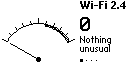
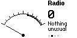
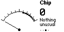
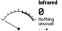

# Safety Sweep

A Flipper Zero app for sweeping a hotel room or rental for signs of hidden cameras, using only what is built into the device. No add-on boards.

   

One analog dial, four pages. The needle rises as you get closer to a source, a dot holds the recent peak, and it clicks like a Geiger counter. Next to the dial it says in words what the reading means. Sound and vibration follow the Flipper's own volume and stealth settings.

| Page | Sensor | Responds to | Status |
|---|---|---|---|
| **Wi-Fi 2.4** | Bluetooth radio, 2402–2478 MHz in 4 MHz steps | Anything transmitting on 2.4 GHz: Wi-Fi cameras, but equally phones, laptops and routers | Tested: a channel scan showed a clear rise on the channels of nearby Wi-Fi networks, and the dial reaches 100 next to a router. Firmware 1.5.1 only, see below |
| **Radio** | CC1101, 300–348 / 387–464 / 779–928 MHz | Analog video senders, wireless microphones, key fobs, and any other transmitter in those bands | Reads live signal levels. Not yet tried against a real video sender |
| **Chip** | CC1101, narrow sweep at 398–402 / 794–806 / 844–856 MHz | Meant for the radio noise a recording camera's memory leaks. Phones and cell towers use the same frequencies and move it too | Experimental. The idea is from the ESauron paper below, which used lab radio equipment. Not yet tried against a real camera |
| **Infrared** | IR remote receiver | Infrared pulsed at about 38 kHz, which in practice means remote controls | Does not see ordinary night-vision light, which is steady |

A quiet dial does not prove a room is clean, and a moving needle does not prove a camera. 5 GHz Wi-Fi, wired, cellular and idle cameras are invisible to this hardware. Look for lenses with a torch as well.

## Use

1. Open **Apps → Tools → Safety Sweep** in the middle of the room and hold still for two seconds while it learns the room's normal level.
2. Move the Flipper slowly along walls, shelves, clocks, chargers, smoke alarms and vents. Follow the needle; the dot shows where it was highest.
3. Left and Right change the page. **OK** relearns the room level, for when you walk into another room. **Back** exits.
4. On the **Chip** page hold the Flipper within a hand's width of a suspect object. Switching the room light on and off makes a camera's encoder work harder, so a needle that moves with the light is a strong hint.

## How the Wi-Fi 2.4 page works

The firmware's own signal-strength call, `furi_hal_bt_get_rssi`, sends `ACI_HAL_READ_RAW_RSSI`, which ST removed from every build of the radio stack, so it always reports a failed read. The stack's replacement, `ACI_HAL_READ_RSSI`, works, but the firmware does not call it and does not export the function that sends radio commands to apps.

Safety Sweep sends the working command through that function's address, which is fixed per firmware build. The table of known builds is at the top of `app/sensors/sensor_wifi.c`; today it holds official 1.5.1. On any other firmware the page says it is not set up, and the other pages work as usual. After a firmware update, add the new build's address:

```bash
arm-none-eabi-nm firmware.elf | grep hci_send_req
```

The lasting fix is for the firmware to use `ACI_HAL_READ_RSSI` itself.

## Build

```bash
cd app && ufbt launch
```

Builds against the current release SDK and starts the app on a connected Flipper. `ufbt format` and `ufbt lint` use the firmware's code style.

## How it is put together

- `app/sensors/` — one file per sensor behind a three-function interface (`start`, `stop`, `sample`).
- `app/helpers/level.c` — turns raw readings into a steady 0–100 position with zeroing and peak hold.
- `app/views/meter_view.c` — the only screen.
- `app/safety_sweep_app.c` — one worker thread owns the active sensor; a timer drives clicks and vibration.

## Background

- Zhang et al., [ESauron](https://www.usenix.org/conference/usenixsecurity24/presentation/zhang-qibo), USENIX Security 2024: recording cameras radiate at their memory clock (800 and 850 MHz for common DDR2/DDR3 parts).
- Ceccio et al., [Sneaky Spy Devices and Defective Detectors](https://www.usenix.org/conference/usenixsecurity23/presentation/ceccio), USENIX Security 2023: why cheap RF detectors disappoint, and why this app never reports a room as clear.

## License

MIT
